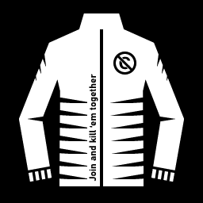

# 🩸 ULTRAKILL Co-op Multiplayer (Enhanced Edition)

<p align="center">
  
</p>

<p align="center">
  <a href="https://github.com/grok57629-stack/ultrakill-coop/releases/latest"></a>
  
  
  
  <a href="LICENSE"></a>
</p>

<p align="center">
  <b>Кооперативный мультиплеер для ULTRAKILL с поддержкой всей сюжетной кампании, синхронизацией мира, кастомизацией скинов и ВХ-никнеймами.</b><br>
  <i>Full campaign cooperative multiplayer mod for ULTRAKILL with complete world sync, chassis recoloring, and wallhack nametags.</i>
</p>

---

> [!IMPORTANT]
> **Уведомление об авторстве / Authorship Disclaimer:**  
> 🇷🇺 **Оригинальным создателем и автором мода Jaket является [xzxADIxzx](https://github.com/xzxADIxzx)** ([оригинальный репозиторий](https://github.com/xzxADIxzx/Join-and-kill-em-together)).  
> **Я ни в коем случае не присваиваю себе авторство оригинального проекта.** Это сообщественная доработка (Enhanced Fork), созданная исключительно с целью развить мод: добавить полную поддержку Актов 1–3 (Layer 7 Violence), общую синхронизацию мира (стены, рубильники, щитки, черепа), ВХ-метки союзников, выбор цветов шасси робота и исправить баги рассинхрона. Все лавры за создание мультиплеера принадлежат оригинальному автору!  
>  
> 🇬🇧 **The original creator and author of the Jaket mod is [xzxADIxzx](https://github.com/xzxADIxzx)** ([original repo](https://github.com/xzxADIxzx/Join-and-kill-em-together)).  
> **I do NOT claim original authorship of the mod.** This repository is an enhanced community fork created solely to build upon their foundation — adding full Act 1-3 sync, breakable/breaker world synchronization, custom chassis colors, wallhack nametags, and bug fixes for the community.

---

## 🌐 Выберите язык / Select Language
- 🇷🇺 [**Русская версия (Russian Documentation)**](#-русская-версия)
- 🇬🇧 [**English Version (English Documentation)**](#-english-version)

---

# 🇷🇺 Русская версия

## 📖 Описание
**ULTRAKILL Co-op Enhanced** — модификация для ULTRAKILL, превращающая одиночный ультранасильственный шутер в полноценный кооперативный экшен для компании от 2 до 16 игроков. 

Оригинальный мод был разработан **[xzxADIxzx](https://github.com/xzxADIxzx)**. Данная доработка расширяет его возможности: добавляет поддержку всех глав (включая Слой 7 «Насилие»), синхронизацию разрушаемых стен, электрощитков, дверей и головоломок, встроенные ВХ-никнеймы сквозь стены и выбор цвета корпуса для каждого игрока.

---

## ✨ Новые возможности и улучшения (v2.1.0 Enhanced)

### 🩸 1. Полная поддержка кампании (Акты I, II, III + Прайм-святилища)
- **Все акты игры**: Полная совместимость с Прологом, Актом I (Prelude, Limbo, Lust, Gluttony), Актом II (Greed, Wrath, Heresy) и **Актом III: Слой 7 «Насилие»** (7-1, 7-2, 7-3, 7-4).
- **Прайм-святилища**: Совместное прохождение сложнейших боссов — **P-1 (Minos Prime)** и **P-2 (Sisyphus Prime)**.
- **Дополнительные режимы**: Кибергринд (Cyber Grind) в кооперативе, Песочница (Sandbox) и уровни с секретами.

### 🎨 2. Кастомизация цвета тела/шасси робота
- Выбирайте цвет корпуса прямо в меню **F1**:
  - 🔵 **V1 Blue** (Классический синий)
  - 🔴 **V2 Red** (Рубиновый красный)
  - 🟢 **V3 Green** (Изумрудный зеленый)
  - 🟡 **Gold** (Золотой металлик)
  - 🌸 **Pink** (Неоновый розовый)
  - 🟣 **Gabriel Purple** (Пурпурный Габриэля)
  - 🟠 **Swordsmachine Orange** (Оранжевый мечника)
  - ⚪ **Mirage White** (Белоснежный мираж)
  - ⚫ **Stealth Black** (Скрытный черный)
  - 💠 **Minos Cyan** (Бирюзовое сияние Миноса)
- **Полная сетевая синхронизация**: Другие игроки видят ваш цвет в реальном времени.
- **Вид от первого лица**: Правая рука и оружие окрашиваются в выбранный вами цвет.

### 🌐 3. Полная синхронизация мира и квестов
- **Общие предметы**: Черепа (красные, синие, зеленые), факелы, мыло и плюшевые игрушки больше не раздваиваются при подборе.
- **Разрушаемые стены (`Breakable`)**: Пробитая стена мгновенно разрушается у всех подключенных игроков.
- **Электрощитки (`Zappable`)**: Выстрел по щитку активирует питание у всех участников сессии.
- **Рычаги, кнопки и двери**: Все секретные переключатели (включая лимбо-кнопки), гермодвери и контроллеры головоломок синхронизированы.

### 👁️ 4. ВХ-Никнеймы сквозь стены (Wallhack Nametags)
- Имена союзников и шкалы здоровья теперь **всегда видны сквозь любые стены и препятствия**.
- Отображение точной дистанции до тиммейта в метрах.
- Динамическое масштабирование: размер шрифта адаптируется под расстояние, поэтому ник не закрывает обзор на больших дистанциях.

### ⚡ 5. Исправление синхронизации движения
- Исправлен визуальный баг, когда моделька напарника могла зависнуть на одном месте, пока он бегал и стрелял.

### 🇷🇺 6. Русский интерфейс
- Все меню лобби, браузер серверов, подсказки и настройки переведены на чистый русский язык.

---

## 📥 Быстрая установка

### Способ 1: Готовая установка (Рекомендуется)
1. Перейдите во вкладку [**Releases**](https://github.com/grok57629-stack/ultrakill-coop/releases/latest) и скачайте архив `ULTRAKILL-Coop-Mod.zip`.
2. Распакуйте содержимое архива в папку с игрой ULTRAKILL:
   - Путь Steam по умолчанию:  
     `C:\Program Files (x86)\Steam\steamapps\common\ULTRAKILL\`
3. Убедитесь, что файл `Jaket.dll` находится по пути:  
   `.../ULTRAKILL/BepInEx/plugins/Jaket/Jaket.dll`
4. Запустите игру.

### Способ 2: Через Mod Manager (r2modman)
1. Установите [r2modman](https://github.com/ebkr/r2modmanPlus).
2. Выберите ULTRAKILL и создайте профиль.
3. Установите BepInExPack.
4. Добавьте `Jaket.dll` и папку `assets` в папку плагинов профиля.

---

## 🎮 Как играть и управление

1. Запустите ULTRAKILL.
2. В главном меню или прямо на уровне нажмите **`F1`**, чтобы открыть панель мультиплеера.
3. **Создание сервера (Хост)**:
   - Нажмите **Создать лобби**.
   - Выберите тип: *Публичное*, *Только друзья* или *Приватное*.
   - Скопируйте **Код лобби** (кнопка копирования в меню) и отправьте другу, либо пригласите его через Steam Overlay (`Shift + Tab`).
4. **Подключение (Клиент)**:
   - Нажмите `F1`, вставьте полученный код лобби в поле ввода и нажмите **Присоединиться**.
   - Либо откройте вкладку **Список серверов** и выберите открытое лобби.
5. **Настройка внешности**:
   - Откройте вкладку **Игроки** или **Настройки** в меню `F1`.
   - Кликайте по палитре цветов, чтобы мгновенно сменить окраску шасси робота.

---

## 🛠️ Сборка из исходников
Для компиляции проекта потребуется **.NET SDK 10.0** или совместимый .NET 8/9 SDK.

```powershell
# Клонируйте репозиторий
git clone https://github.com/grok57629-stack/ultrakill-coop.git
cd ultrakill-coop

# Укажите путь к папке игры в Path.props при необходимости
# Скомпилируйте проект
dotnet build -c Release
```
Готовая библиотека будет собрана в `bin/Release/netstandard2.1/Jaket.dll`.

---

## 📜 Благодарности и лицензия
- 👑 **Оригинальный автор мода:** **[xzxADIxzx](https://github.com/xzxADIxzx)** — создатель [Jaket (Join-and-kill-em-together)](https://github.com/xzxADIxzx/Join-and-kill-em-together). Огромное спасибо за великолепный мод и основу сетевого кода!
- 🛠️ **Доработка и улучшения (Enhanced Edition):** [grok57629-stack](https://github.com/grok57629-stack).
- 💬 **Дискорд оригинального проекта:** [Jaket Discord Server](https://discord.gg/USpt3hCBgn)
- ⚖️ **Лицензия:** Проект распространяется под свободной лицензией **GNU General Public License v3.0** (GPL-3.0). Подробнее в файле [LICENSE](LICENSE).

---
<br>

# 🇬🇧 English Version

## 📖 Overview
**ULTRAKILL Co-op Enhanced** brings full-fledged cooperative multiplayer to ULTRAKILL for 2 to 16 players. Experience the breakneck speed and ultra-violence of Hell alongside your friends.

The original project was created by **[xzxADIxzx](https://github.com/xzxADIxzx)**. This enhanced edition is a community fork that adds complete Act I–III campaign support (including Layer 7 Violence), synchronized world objects (breakables, breakers, switches, puzzles), wallhack nametags, and player chassis recoloring.

---

## ✨ Features & Enhancements (v2.1.0 Enhanced)

### 🩸 1. Full Campaign Support (Acts I, II, III & Prime Sanctums)
- **Complete Story Progression**: Seamless co-op playthrough from the Prelude all the way through Act I, Act II, and **Act III: Layer 7 Violence** (7-1, 7-2, 7-3, 7-4).
- **Prime Sanctums**: Fight **P-1 (Minos Prime)** and **P-2 (Sisyphus Prime)** together in real-time.
- **Cyber Grind & Sandbox**: High-wave co-op arena battles and sandbox messing around.

### 🎨 2. Custom Chassis & Body Colors
- Choose your robot's chassis color directly from the **F1** menu:
  - 🔵 **V1 Blue**
  - 🔴 **V2 Red**
  - 🟢 **V3 Green**
  - 🟡 **Gold Metallic**
  - 🌸 **Pink Neon**
  - 🟣 **Gabriel Purple**
  - 🟠 **Swordsmachine Orange**
  - ⚪ **Mirage White**
  - ⚫ **Stealth Black**
  - 💠 **Minos Cyan**
- **Network Synchronized**: Other players immediately see your custom color in the lobby and on the battlefield.
- **First-Person View**: Your right arm and weapons reflect the selected chassis tint.

### 🌐 3. Global World & Quest Synchronization
- **Shared Pickups**: Skulls (Red, Blue, Green), torches, soap, and plushies are globally synced and won't duplicate.
- **Breakable Walls (`Breakable`)**: Shattered walls sync immediately across all connected clients.
- **Breaker Boxes (`Zappable`)**: Electric fuse boxes react to electric revolver and railcannon shots globally.
- **Switches & Doors**: Limbo switches, heavy blast doors, and secret puzzle controllers are synchronized.

### 👁️ 4. Wallhack Nametags
- Teammate nametags and health bars are **always rendered through walls and geometry**.
- Dynamic distance meter displays exactly how far your partner is.
- Smart scaling ensures clear visibility without obscuring distant targets.

### ⚡ 5. Movement Desync Fix
- Resolved the visual bug where a teammate's puppet model could freeze in place while they were running and dashing.

### 🌍 6. Dual Localization (Russian & English)
- Full bilingual support for all menus, lobby settings, tooltips, and chat.

---

## 📥 Quick Installation

### Option 1: Standalone Package (Recommended)
1. Download `ULTRAKILL-Coop-Mod.zip` from the latest [**Releases**](https://github.com/grok57629-stack/ultrakill-coop/releases/latest).
2. Extract the archive into your ULTRAKILL game directory:
   - Steam default path:  
     `C:\Program Files (x86)\Steam\steamapps\common\ULTRAKILL\`
3. Verify that `Jaket.dll` is located at:  
   `.../ULTRAKILL/BepInEx/plugins/Jaket/Jaket.dll`
4. Launch the game and press `F1`.

### Option 2: Using Mod Manager (r2modman)
1. Install [r2modman](https://github.com/ebkr/r2modmanPlus).
2. Select ULTRAKILL and install BepInExPack.
3. Import or place `Jaket.dll` and the `assets` folder into your profile plugins directory.

---

## 🎮 How to Play & Controls

| Key / Action | Function |
|---|---|
| **`F1`** | Toggle Multiplayer Menu |
| **Host Lobby** | Create Public, Friends-Only, or Private session |
| **Join Lobby** | Paste Lobby Code or use the Server Browser |
| **Steam Invite** | Press `Shift + Tab` to invite friends via Steam |
| **Color Picker** | Change chassis skin in `Players` or `Settings` tabs |

---

## 🛠️ Building from Source
Requirements: **.NET SDK 10.0** (or .NET 8/9).

```powershell
git clone https://github.com/grok57629-stack/ultrakill-coop.git
cd ultrakill-coop
dotnet build -c Release
```
The compiled binary will be placed at `bin/Release/netstandard2.1/Jaket.dll`.

---

## 📜 Credits & License
- 👑 **Original Mod Author:** **[xzxADIxzx](https://github.com/xzxADIxzx)** — creator of [Jaket (Join-and-kill-em-together)](https://github.com/xzxADIxzx/Join-and-kill-em-together). Huge respect and appreciation for the original multiplayer mod!
- 🛠️ **Enhanced Edition & Modifications:** [grok57629-stack](https://github.com/grok57629-stack).
- 💬 **Original Discord Server:** [Jaket Discord](https://discord.gg/USpt3hCBgn)
- ⚖️ **License:** Licensed under the **GNU General Public License v3.0** (GPL-3.0). See [LICENSE](LICENSE) for details.
